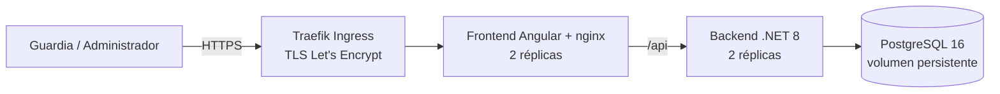

# SCIAD: Sistema de Control Integral de Identidad y Acceso Digital

Control de ingreso y egreso con credenciales QR, desplegado en Kubernetes.
Proyecto final del Seminario, Universidad Mariano Gálvez de Guatemala.

- **Autor:** José Leonel Salazar Tejeda (carné 7690-22-8974)
- **Aplicación desplegada:** https://jsalazart3-sciad.duckdns.org
- **Informe final (PDF):** ver la entrega del curso
- **Licencia:** propietaria, todos los derechos reservados (ver [LICENSE](LICENSE))

> La aplicación desplegada puede estar apagada fuera de los horarios de evaluación (el clúster del salón se pausa entre sesiones).

## 1. El problema

En el Instituto Mixto Indo Latino el ingreso y el egreso del estudiantado se registraban en bitácoras de papel. Cada guardia dedicaba cerca de 2 horas por semana (unas 104 horas al año) a transcribir esos registros, sin validar la identidad, sin historial consultable y sin alertas ante accesos indebidos. La raíz del problema es que el registro depende de una persona que escribe a mano: es lento, propenso a errores, fácil de falsear y casi imposible de auditar.

## 2. La solución

SCIAD sustituye la bitácora por un sistema web con credenciales de código QR:

- **QR único por persona:** token aleatorio de 256 bits generado con un generador criptográfico, cifrado en la base de datos.
- **Control por zonas y roles:** perfiles de acceso por zona (puerta principal, puerta secundaria, bodega) y matriz de roles (RBAC) verificada en 32 endpoints.
- **Validación inmediata:** el guardia escanea el QR y el sistema decide si el acceso es válido, lo registra una sola vez (restricción UNIQUE por persona, fecha y tipo) y muestra una alerta roja con el motivo si la credencial está revocada, inactiva, vencida o la zona no está autorizada.
- **Auditoría:** cierre nocturno automático (00:05, hora de Guatemala), baja lógica y reportes consultables.

## 3. Arquitectura



| Capa | Tecnología |
|---|---|
| Frontend | Angular, servido por nginx (CSP con nonce, HSTS, cabeceras OWASP) |
| Backend | .NET 8, Entity Framework Core, JWT HS256 (8 h), bcrypt |
| Base de datos | PostgreSQL 16 (StatefulSet con volumen persistente) |
| Orquestación | Kubernetes (k3s), Traefik, cert-manager |
| Registro de imágenes | GitHub Container Registry (privado) |

## 4. Despliegue en Kubernetes

Manifiestos en [`k8s/`](k8s/) (kustomize), con namespace propio:

| Archivo | Contenido |
|---|---|
| `00-configmap-nginx.yaml` | Configuración de nginx (CSP, HSTS, proxy `/api/`, `/healthz`) |
| `01-secret.example.yaml` | Plantilla del Secret, **sin valores** |
| `02-db.yaml` | StatefulSet PostgreSQL 16, volumen de 2 Gi, probes `pg_isready` |
| `03-backend.yaml` | Deployment (2 réplicas), RollingUpdate sin indisponibilidad, no root, probes, preStop, PodDisruptionBudget |
| `04-frontend.yaml` | Deployment (2 réplicas), mismas prácticas |
| `05-ingress.yaml` | Ingress con TLS automático |
| `06-networkpolicy.yaml` | Denegar por defecto; solo frontend→backend (8080) y backend→base de datos (5432) |

**Requisitos:** acceso a un clúster Kubernetes con Traefik y cert-manager (ClusterIssuer `letsencrypt`), `kubectl` con el kubeconfig del namespace, Docker, y acceso al registro de imágenes.

```bash
# 1. Namespace (o el asignado) y contexto
kubectl config set-context --current --namespace=<tu-namespace>

# 2. Imágenes: construir y subir al registro (pide el token sin mostrarlo)
./scripts/subir-imagenes.sh 1.0.0

# 3. Secretos (se crean desde un .env.prod local que NO se versiona, y el secreto de descarga del registro)
./scripts/crear-secretos.sh

# 4. Aplicar los manifiestos
kubectl apply -k k8s/

# 5. Verificar
kubectl get pods,svc,ingress,certificate,pvc
curl -s https://<tu-dominio>/api/health   # {"status":"ok","database":"up"}
```

Variables de entorno necesarias en el `.env.prod` (solo los nombres; **nunca se suben los valores**): `POSTGRES_DB`, `POSTGRES_USER`, `POSTGRES_PASSWORD`, `SCIAD_JWT_SECRET`, `QR_ENCRYPTION_KEY`, `SCIAD_CORS_ORIGINS`, `ALLOWED_HOSTS`, `RATE_LIMIT_LOGIN_PERMIT`, `RATE_LIMIT_LOGIN_WINDOW`, `SCIAD_ADMIN_EMAIL`, `SCIAD_ADMIN_PASSWORD`. El administrador inicial se crea con las dos últimas; no hay credenciales de demostración publicadas.

También hay despliegue con Docker Compose (ver [`DESPLIEGUE.md`](DESPLIEGUE.md)) y la guía operativa del clúster en [`DESPLIEGUE_KUBERNETES.md`](DESPLIEGUE_KUBERNETES.md).

## 5. Pruebas

```bash
# Backend: 162 pruebas unitarias (xUnit)
dotnet test sciad-backend/tests/Sciad.Tests

# Verificaciones de seguridad y reglas de negocio contra una instancia en ejecución
node sciad-backend/verify-owasp.mjs
node sciad-backend/verify-seguridad.mjs
node sciad-backend/verify-validaciones.mjs
node sciad-backend/verify-estados.mjs
node sciad-backend/verify-cierre.mjs
```

Las 11 suites del proyecto suman 611 comprobaciones aprobadas (162 xUnit, 152 seguridad, 68 OWASP Top 10, 46 zona horaria, 35 estados, 33 validaciones, 33 CSP, 28 E2E, 25 E2E real, 15 campo DPI y 14 cierre nocturno).

## 6. Resultados de seguridad

Mediciones del 12 de noviembre de 2026 sobre lo desplegado:

| Prueba | Resultado |
|---|---|
| SSL Labs | A+ (TLS 1.3, HSTS, intercambio post-cuántico) |
| OWASP ZAP baseline | 0 fallos, 0 High, 0 Medium, 4 Low, 5 informativos, 62 pruebas pasadas |
| Gitleaks | 0 secretos reales (2 falsos positivos verificados, ver `.gitleaksignore`) |
| Trivy, imagen frontend (Alpine 3.21.3) | 70 altos/críticos, todos con parche; la base de la imagen ya no tiene soporte |
| Trivy, imagen backend (Debian 12.15 + .NET 8.0.32) | 111 altos/críticos; 9 con parche y 102 sin parche del proveedor |
| Trivy config sobre `k8s/` | 22 hallazgos (2 altos, 7 medios, 13 bajos); Ingress y NetworkPolicy sin hallazgos |

El detalle, los hallazgos abiertos y su justificación están en el informe final.

## 7. Limitaciones conocidas

- Dentro de Kubernetes el backend ve la IP del proxy para todos los clientes: el límite de intentos de login es compartido (30 cada 300 s).
- El contador de intentos de login vive en memoria de cada réplica.
- Bases de imagen desactualizadas (Alpine 3.21 en el frontend, runtime .NET 8.0.32) y contenedores de nginx y PostgreSQL con más privilegios de los necesarios: plan de corrección en el informe.
- En una ráfaga sintética de 500 ingresos simultáneos el P95 fue de 3 961 ms (objetivo: 2 000 ms); en el escenario realista fue de 53 ms.
- El token de sesión se guarda en `localStorage`, mitigado con una CSP con nonce.

## 8. Estructura del repositorio

```
sciad-backend/     API .NET 8, migraciones, pruebas y scripts verify-*.mjs
sciad-frontend/    Aplicación Angular y configuración de nginx
k8s/               Manifiestos de Kubernetes (kustomize)
scripts/           Construcción de imágenes, creación de secretos, migración de datos
Documentacion/     Documentación técnica del proyecto
evidencia_visual/  Capturas de la aplicación
```

## 9. Uso de inteligencia artificial

Parte del desarrollo, las pruebas y la redacción se hizo con apoyo de un asistente de IA (Claude, de Anthropic). El autor revisó, ejecutó y es responsable del resultado. Los commits generados con ese apoyo llevan la coautoría declarada.

## 10. Licencia

Software propietario. Todos los derechos reservados. Se permite ver y ejecutar el código solo para evaluación académica de este proyecto. Ver [LICENSE](LICENSE). Los componentes de terceros conservan sus licencias (ver `THIRD_PARTY_LICENSES.md`).
